# HRMS: a Flask app on AWS with CI/CD, Terraform and monitoring


A Flask + MySQL HR system (leave requests, attendance, HR and employee roles) used as the workload for a
production-style DevOps pipeline on AWS. The app is deliberately small. The focus of this project is everything
around it: containers, CI/CD, infrastructure as code, secrets, monitoring and safe releases.

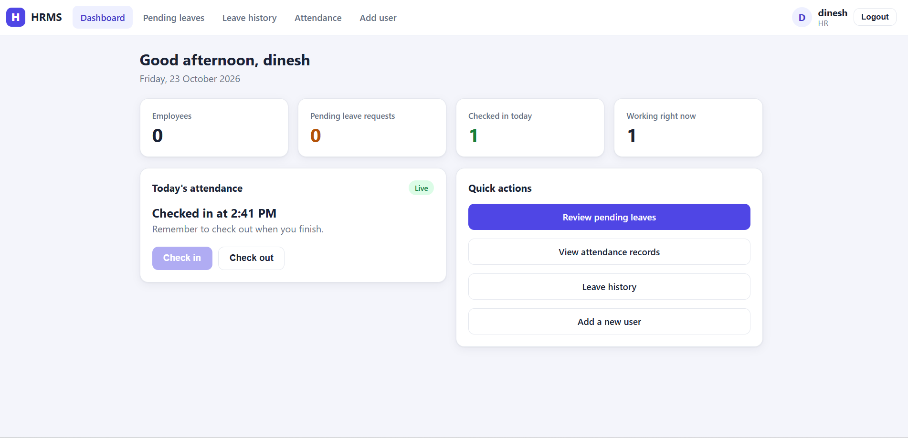

## Architecture

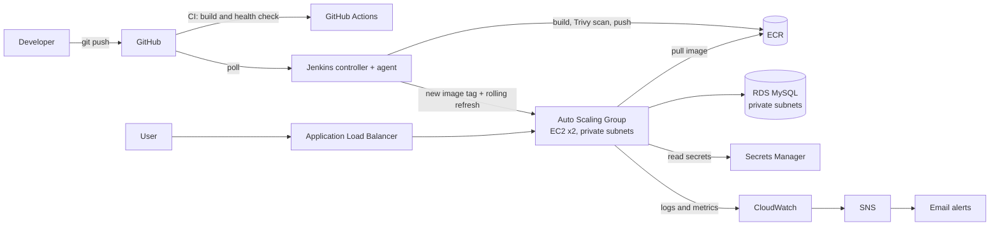

## What is inside

| Area | Tools |
|---|---|
| Application | Python, Flask, MySQL, Gunicorn |
| Containers | Docker, Docker Compose, Kubernetes manifests (tested on a local kind cluster) |
| CI | GitHub Actions: build the image and check `/health` on every push and pull request |
| CD | Jenkins controller + agent: build, Trivy image scan, push to ECR, rolling release with automatic rollback |
| Infrastructure | Terraform: VPC (public and private subnets, NAT), ALB, Auto Scaling Group, RDS MySQL, ECR, IAM, S3 remote state with locking |
| Secrets | AWS Secrets Manager, IAM roles (no access keys on servers) |
| Monitoring | CloudWatch dashboard, alarms, log metric filter, SNS email alerts |
| Earlier stage | Ansible + Ansible Vault deployment to a single EC2 server (kept in `ansible/`) |

## The application

- Sign up and log in (hashed passwords, CSRF protection on every form)
- **Employee:** check in and out, request leave, cancel a pending request, view leave history and attendance
- **HR:** dashboard with live numbers, approve or reject leave with a comment, searchable history and attendance, add users
- HR accounts cannot be self-created once an HR account exists
- `/health` checks the app and the database; `/live` only checks that the process is alive

## How a release works

1. A push to `main` triggers Jenkins.
2. Jenkins builds the image and scans it with Trivy (the build fails on fixable CRITICAL findings).
3. The image is pushed to ECR with an immutable tag, for example `12-a1b2c3d` (build number + commit).
4. The tag is written to SSM Parameter Store, and an Auto Scaling instance refresh replaces servers one at a time.
5. If the refresh does not finish healthy, the pipeline restores the previous tag and fails.

The load balancer checks `/live`, so a database outage does not make the Auto Scaling Group terminate healthy
servers. The pipeline checks `/health`, which includes the database.

## Repository layout

```
.
├── routes.py, models.py, config.py, templates/, static/   # the Flask app
├── Dockerfile, docker-compose.yml                         # local run
├── .github/workflows/ci.yml                               # GitHub Actions
├── Jenkinsfile, jenkins/                                  # pipeline and Jenkins setup
├── infra/
│   ├── bootstrap/        # S3 bucket for Terraform state (run once)
│   ├── foundation/       # ECR, Jenkins IAM role, image tag parameter (always on)
│   ├── modules/vpc/      # reusable network module
│   ├── envs/dev/         # ALB, ASG, RDS, secrets, monitoring (disposable)
│   ├── up.sh, down.sh    # create and destroy the dev environment
├── k8s/                  # Kubernetes manifests
├── ansible/              # first deployment method (single server)
└── docs/                 # diagrams, screenshots, runbook
```

## Run it locally

```bash
cp .env.example .env        # change the passwords and secret key
docker compose up -d --build
curl http://localhost:5000/health
```

Open http://localhost:5000 and create the first account with the role **HR**.

## Deploy to AWS

Requires Terraform 1.10 or newer and AWS credentials with enough permissions.

```bash
# once: state bucket and always-on resources
cd infra/bootstrap  && terraform init && terraform apply
cd ../foundation    && terraform init && terraform apply

# push an image first (run the Jenkins pipeline), then:
MY_IP=<your-public-ip> ALERT_EMAIL=you@example.com ./infra/up.sh

# when finished
./infra/down.sh
```

Confirm the SNS subscription email, otherwise alarm emails are not delivered.

## Cost and teardown

The dev environment is **56 Terraform-managed resources** (the number shown in the destroy plan).
The NAT gateway, load balancer and Multi-AZ RDS bill by the hour, so the environment is created for a working
session and destroyed afterwards. ECR, the state bucket and IAM live in a separate layer and survive teardown.
Measured cost of the testing sessions: **[fill in from Cost Explorer]**.

## Security decisions

- App servers and the database are in private subnets; the database accepts traffic only from the app security group
- IAM roles are scoped to one ECR repository, one secret and one parameter
- Secrets live in Secrets Manager and are read at boot into a root-only file; nothing sensitive is baked into images
- Immutable image tags, scan on push and a Trivy scan in the pipeline
- Terraform state is stored in S3 with versioning, encryption and locking
- Load balancer access is limited to specific IP addresses while the project is a demo

## Screenshots

### The application

| | |
|---|---|
| 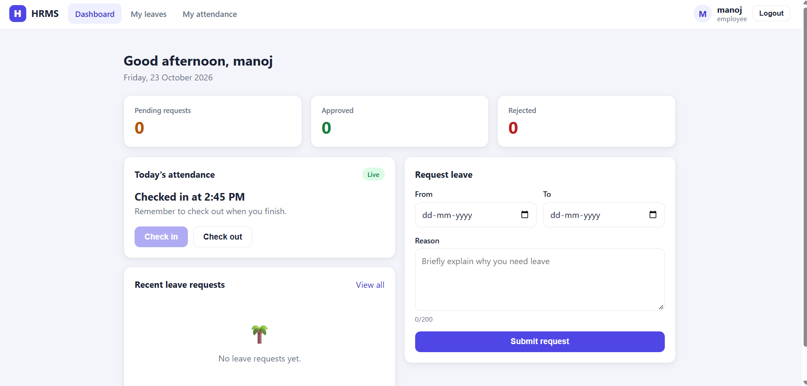 | 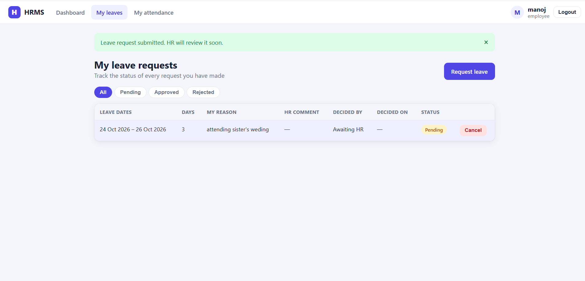 |
| Employee dashboard: attendance, request counts, leave form | Submitting a leave request and tracking its status |
| 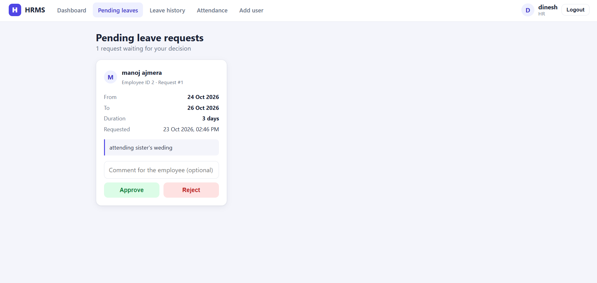 | 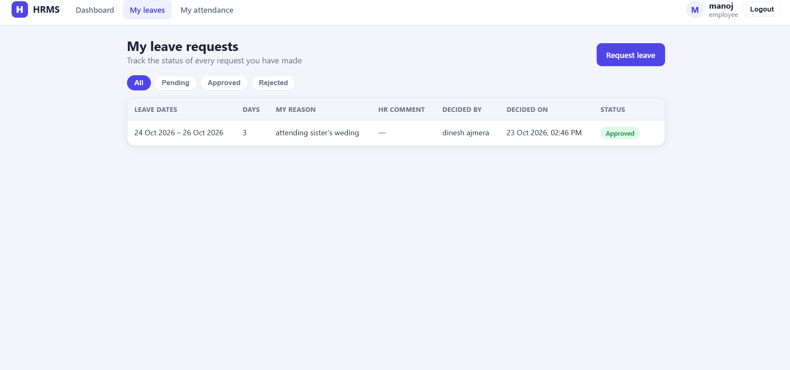 |
| HR reviews the pending request | The employee sees the decision |

### CI/CD

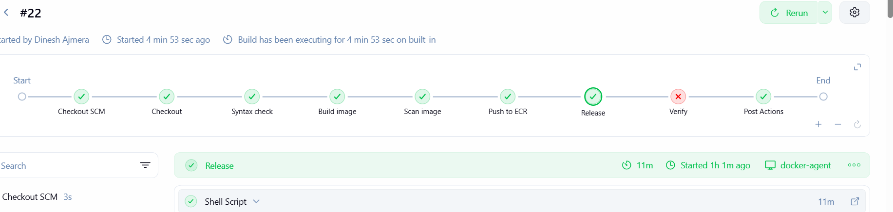

Pipeline stages: checkout, syntax check, image build, Trivy scan, push to ECR and release to the Auto Scaling Group.

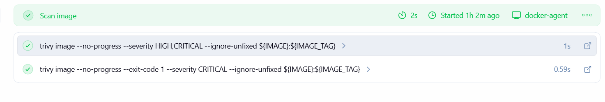

The scan reports HIGH and CRITICAL findings and fails the build only on fixable CRITICAL ones.

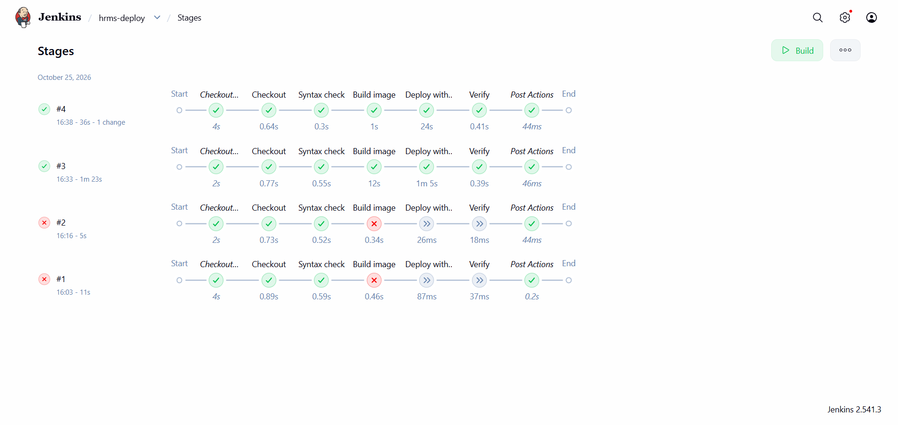

Early runs of the pipeline (the Ansible-based version): builds #1 and #2 failed at the image build stage and passed
after the fix described under "Problems I hit".

### Monitoring and health checks

| | |
|---|---|
| 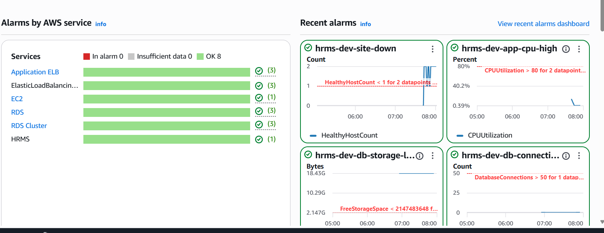 | 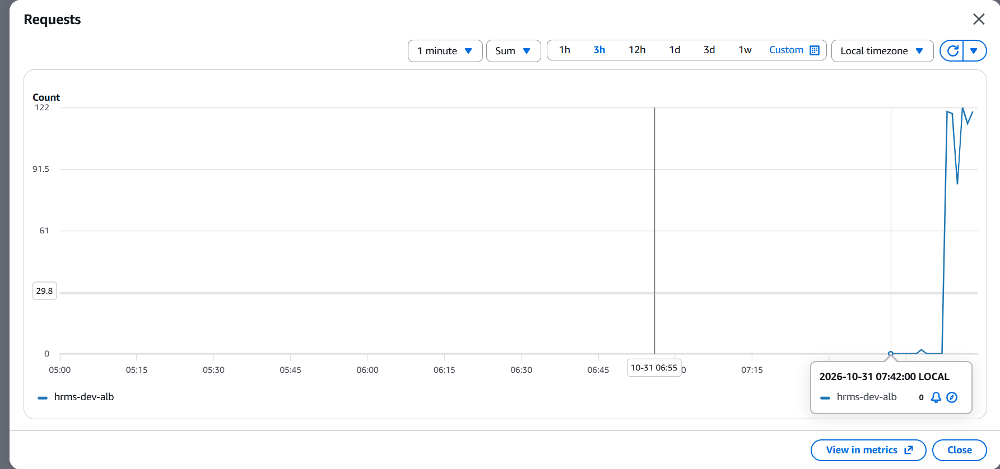 |
| CloudWatch alarm overview: 8 alarms, all OK | Load balancer requests per minute during a test with a `curl` loop |

| `/health` when the database was unreachable | `/health` when everything is healthy |
|---|---|
|  | 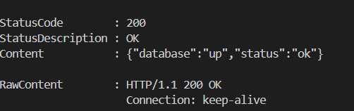 |

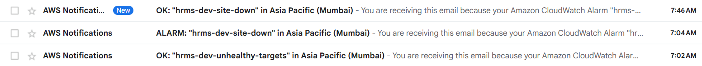

SNS alarm emails: the `site-down` alarm fired and later returned to OK.

## Problems I hit and how I fixed them

- **Docker not found in the Jenkins agent:** the base image no longer shipped the `docker` command with `docker.io`;
  the Dockerfile now installs `docker-cli` and falls back to `docker.io`.
- **Deploy stage could not reach the server:** the security group allowed only my own IP, not the Jenkins server's.
- **Auto Scaling failed on first use:** the account's Auto Scaling service-linked role had to exist before the group
  could validate the load balancer.
- **Terraform state lock left behind** by an interrupted apply: verified nothing was running, then used
  `terraform force-unlock`. Long runs now happen inside `tmux`.
- **Instance could not reach its credentials from a container:** the metadata hop limit had to be raised for containers.

## Known limitations and next steps

- HTTP only; next step is a domain, an ACM certificate and an HTTPS listener
- The app uses the RDS master user; next step is a least-privilege MySQL user and secret rotation
- Kubernetes was tested on a local cluster, not on EKS
- Jenkins polls GitHub instead of using webhooks
- A single NAT gateway is used to keep cost down; production would use one per Availability Zone

## Author

Dinesh Ajmera, [LinkedIn](https://www.linkedin.com/in/dinesh-ajmera/), [GitHub](https://github.com/dinesh-ajmera)
