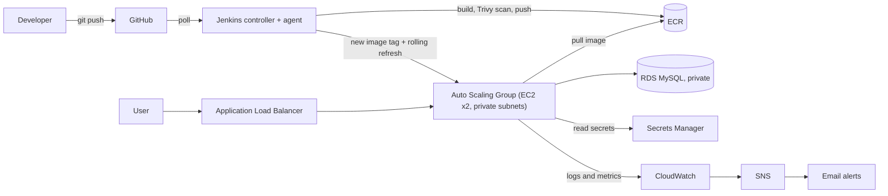

# HRMS: Flask app on AWS with CI/CD, Terraform and monitoring

A Flask + MySQL HR system (leave requests, attendance, roles) used as the
workload for a production-style DevOps pipeline on AWS.

## Architecture

## What's inside
| Area | Tools |
|---|---|
| App | Python, Flask, MySQL, Gunicorn |
| Containers | Docker, Docker Compose, Kubernetes manifests (tested on kind) |
| CI | GitHub Actions (build + health-check test) |
| CD | Jenkins controller + agent: build, Trivy scan, push to ECR, rolling release with automatic rollback |
| Infrastructure | Terraform: VPC (public/private subnets, NAT), ALB, ASG, RDS, ECR, IAM, S3 remote state |
| Secrets | AWS Secrets Manager, IAM roles (no keys on servers) |
| Monitoring | CloudWatch dashboard, alarms, log metric filter, SNS email alerts |

## How a release works
1. Push to `main`.
2. Jenkins builds the image, scans it with Trivy, pushes it to ECR with an immutable tag.
3. The new tag is written to SSM Parameter Store and an Auto Scaling instance refresh replaces servers one at a time.
4. If the refresh fails, the pipeline restores the previous tag.

## Run it locally
`cp .env.example .env && docker compose up -d --build` then open http://localhost:5000

## Deploy to AWS
`./infra/up.sh` creates the environment; `./infra/down.sh` destroys it.
Layers: `infra/foundation` (always on, near-zero cost) and `infra/envs/dev` (disposable).

## Cost and teardown
[Your real number from Cost Explorer.] The NAT gateway, ALB and Multi-AZ RDS bill by the hour,
so the environment is created for a working session and destroyed afterwards.
ECR, the state bucket and IAM live in a separate layer and survive teardown.

## Security decisions
- App servers and database are in private subnets; the database accepts traffic only from the app security group
- IAM roles scoped to one repo / one secret / one parameter
- Immutable image tags, image scanning on push and in the pipeline
- CSRF protection, hashed passwords, HR accounts cannot be self-created
- Terraform state in S3 with versioning, encryption and locking

## Screenshots
[dashboard, target group healthy, Jenkins stage view, alarm email, the app]

## Known limitations and next steps
- HTTP only; next step is a domain + ACM certificate + HTTPS listener
- App uses the RDS master user; next step is a least-privilege MySQL user and secret rotation
- Kubernetes was tested locally, not on EKS
- Ansible was the first deployment method and is kept as an earlier stage
- Jenkins polls GitHub instead of using webhooks